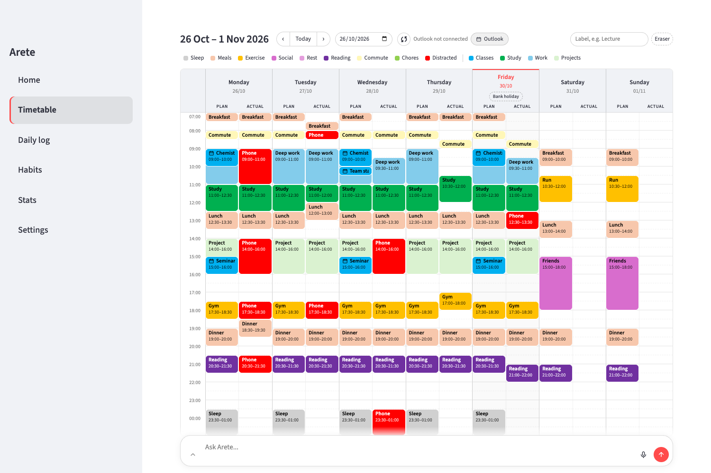
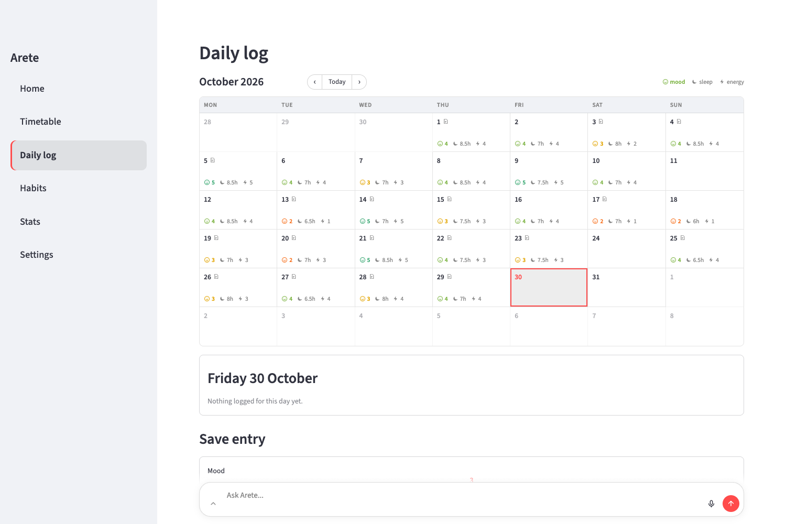
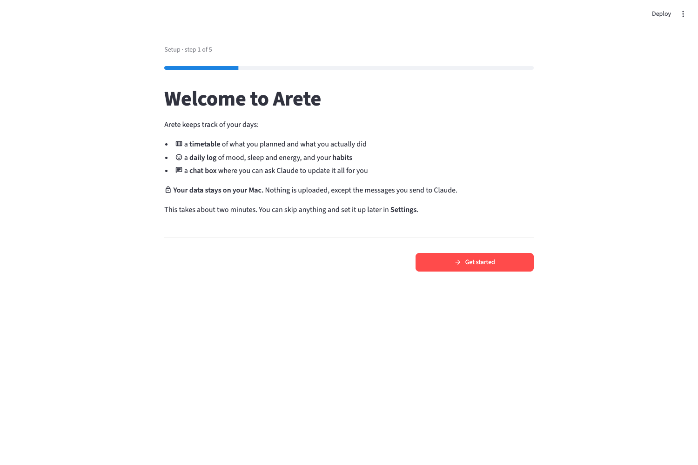
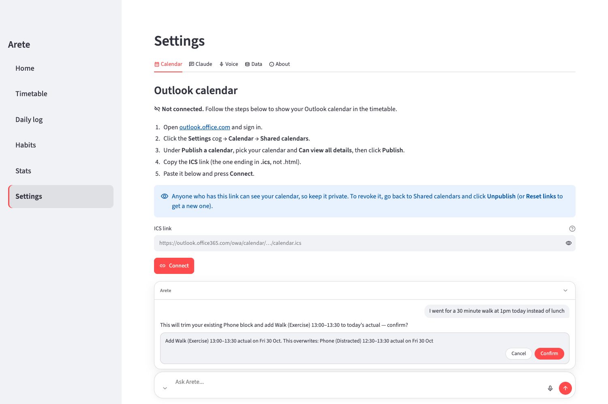

<p align="center">
  
</p>

<h1 align="center">Arete</h1>

<p align="center">
  A personal life tracker for your Mac: a weekly Plan-vs-Actual timetable, a daily log
  of mood, sleep and energy, habits with streaks, to-dos and goals, and a Claude chat box that updates it all for you.
</p>

<p align="center"><em>No summit, just the climb.</em></p>

> **Alpha (v0.1.0-alpha).** Arete works day to day, but it's early: expect rough edges and changes
> between versions, and keep backups (Settings → Data → Back up now). Bug reports and ideas are
> welcome in [Issues](https://github.com/spencertomj1-hue/arete-app/issues).

---

*Arete* (ἀρετή) is the Greek idea of excellence: living up to your potential. Arete helps by recording each day honestly: what you planned, what you actually did, how you felt and which habits you kept.

It runs entirely on your Mac as a normal app. It's built with [Streamlit](https://streamlit.io) and SQLite and shown in its own window. There are no accounts, no servers and no cloud sync.

## Contents

- [Features](#features)
- [Screenshots](#screenshots)
- [Requirements](#requirements)
- [Install](#install)
- [First run](#first-run)
- [Connecting Outlook](#connecting-outlook)
- [Setting up the Claude chat](#setting-up-the-claude-chat)
- [Privacy](#privacy)
- [Limitations](#limitations)
- [Troubleshooting](#troubleshooting)
- [For developers](#for-developers)
- [Licence](#licence)

## Features

**Home.** Today's agenda and timetable on the left. On the right: the box to ask Claude, your to-dos, today's habits to tick (with the last 7 days and your streak), and your goals' progress bars.

**To-dos (on Home).** Today's, this week's and this month's to-do lists, side by side, in the style of Apple Reminders.
- **Ticking off:** click the circle; the to-do moves into a folded "Completed" section. Click it again to untick.
- **Adding and editing:** click "New to-do", type, and press Enter (it stays open for the next one; Esc cancels). Click a title to edit it, drag to reorder, and right-click for notes, repeat, moving to another list, or delete. Repeating to-dos get a fresh copy every new day, week or month.

**Goals.** Measurable targets for the month or the year, like "Gym: 12 sessions" or "Read 20 books", each with a progress bar (on the Goals page and on Home).
- **Progress:** either update it yourself (− / + or type a number), or link the goal to a habit and every day you tick that habit counts.
- **Moving around:** ‹ › shows other months and years.

**Weekly timetable.**
- **Layout:** a calendar-style week. Each day has a **Plan** column (what you intended) and an **Actual** column (what really happened), in 30-minute slots from 07:00 to 01:00. Anything after midnight counts as the previous day.
- **Editing:** drag down a column to add a block, or click a block to see its details, edit it or delete it.
- **Categories:** colour-coded, with groups "Life" and "Work" to start with. Activities pick their category automatically (for example "Lunch" → Meals). You can change categories and colours by asking Claude.
- **Moving around:** use ‹ Today › or a date picker, or swipe sideways on the trackpad.

**Daily Log.** A month calendar showing each day's mood, sleep and energy. Click a day to read its notes, tick that day's habits (with current and best streaks), and save its entry. Habits are added and removed here too.

**Stats.** Charts of mood, energy and sleep, plus habit completion rates.

**Claude chat.** Type or speak what you want changed, for example:
> "I went to the gym from 6 to 7 tonight"
> "Plan a lecture 9 till 11 tomorrow"
> "Mood 4 today, slept 7 and a half hours, tick reading"
> "How much did I actually study this week?"
> "Add go gym to this week's to-dos"
> "Tick off finish problem sheet"
> "Set a goal of 12 gym sessions this month, counting my gym habit"
> "I read 2 more books"

Claude only changes Arete's data, through a fixed set of actions. **Anything that deletes or overwrites data shows a preview with Confirm / Cancel first.** Voice input is transcribed **on your Mac**.

**Outlook calendar (optional).** Your published Outlook calendar appears in the timetable's Plan column, and you can remove or adjust any event. It's read only: nothing is ever written back to Outlook.

**Settings.**
- Calendar connection
- Claude sign-in status
- Microphone test
- Backups, CSV export/import (with separate to-do and goal CSVs) and the data folder

## Screenshots

*All screenshots use made-up demo data (see [For developers](#for-developers)).*

**Home**


**Weekly timetable**



**Asking Claude**


**Daily log**



**First-run setup**



**Settings**



<!-- Placeholders for future screenshots: Images/stats.png, Images/habits.png -->

## Requirements

- **A Mac** running macOS 11 or later (built and tested on macOS 26).
- **Python 3.13.** Install it from [python.org](https://www.python.org/downloads/) or with Homebrew: `brew install python@3.13`.
- **About 2 GB of free disk space:** roughly 1 GB for the packages, plus about 470 MB for the speech model the first time you use the microphone.
- **Optional, for the chat:** [Claude Code](https://docs.claude.com/en/docs/claude-code) signed in with your own Claude account, **or** your own `ANTHROPIC_API_KEY`.

## Install

Open the **Terminal** app and run:

```bash
git clone https://github.com/spencertomj1-hue/arete-app.git
cd arete-app
./setup.sh
```

`setup.sh`:
1. Checks for macOS and Python 3.13.
2. Installs the exact tested package versions into a private `.venv` folder.
3. Builds **Arete.app** in your Applications folder (or `~/Applications`), pointing at the folder you cloned.

It's safe to run again, for example after `git pull`.

Then open **Arete** from Applications, Launchpad or Spotlight. The first time, macOS may say it's from an unidentified developer: right-click Arete → **Open** → **Open**.

## First run

A short setup guide appears the first time. Every step can be skipped, and you can rerun it from **Settings → About**.

1. **Welcome:** what Arete does, and where your data lives.
2. **Claude:** checks whether Claude Code is installed and signed in. If it isn't, it shows the two commands to run, with copy buttons. Everything else works without it.
3. **Outlook calendar (optional):** see below.
4. **Microphone:** explains the macOS permission prompt and lets you test the mic.

## Connecting Outlook

In the setup guide or **Settings → Calendar**:

1. Open [outlook.office.com](https://outlook.office.com) and sign in.
2. Click the **Settings** cog → **Calendar** → **Shared calendars**.
3. Under **Publish a calendar**, pick your calendar and **Can view all details**, then click **Publish**.
4. Copy the **ICS** link (the one ending in `.ics`, not `.html`).
5. Paste it into Arete and press **Connect**.

Arete checks the link, shows how many events it found, and stores the link in your **macOS Keychain**. It syncs when the app opens, every 15 minutes, and when you press ↻.

**Anyone who has the link can see your calendar.** To revoke it, go back to Shared calendars and click **Unpublish** (or **Reset links** to get a new one).

## Setting up the Claude chat

The chat uses **your own** Claude access. Arete has no account or key of its own. Pick one:

- **Claude Code (recommended):**
  1. Install it: `curl -fsSL https://claude.ai/install.sh | bash`
  2. Sign in: `claude auth login`
  3. Arete finds it automatically. **Settings → Claude** shows the status.
- **An API key:** set `ANTHROPIC_API_KEY` in your environment before starting Arete.

Claude can only use Arete's own actions: logging days, ticking habits, editing the timetable, and reading your stats. It has no access to your files, terminal or the web, and doesn't load your other Claude settings or plugins.

## Privacy

**What stays on your Mac:**
- **Your data:** the timetable, daily log, habits and settings, all in `~/Library/Application Support/Arete/`. That folder is outside the app's folder, so it can never end up in git.
- **Voice:** recorded and transcribed locally with [faster-whisper](https://github.com/SYSTRAN/faster-whisper). Audio is never uploaded.
- **Your Outlook link:** stored only in the macOS Keychain.
- **Chat history:** kept in memory while the app is open, and **not saved to disk**. Claude Code runs with session saving turned off.
- **The app itself:** it only listens on `127.0.0.1` (this Mac), with XSRF protection on and Streamlit's usage statistics off.

**What leaves your Mac:**
- **Messages to Claude:** when you use the chat, your message, the recent conversation and whatever data Claude looks up to answer it (for example that week's timetable) go to Anthropic through your Claude Code login or API key, like any Claude conversation.
- **Calendar fetch:** if you connect Outlook, Arete downloads your published calendar from Microsoft.

Nothing else is sent anywhere.

## Limitations

- **Mac only.** It uses the macOS Keychain, the app bundle and the native window.
- **The chat needs your own Claude access:** a Claude Code login or an Anthropic API key.
- **Outlook publishing may be blocked.** Some universities and workplaces turn off "Publish a calendar". If the option is missing, or Outlook refuses the link, ask your IT team.
- **Single user, single Mac.** There's no sync between devices.
- **Timetable hours:** the grid covers 07:00–01:00. Events outside those hours are clipped.

## Troubleshooting

| Problem | What to try |
|---|---|
| **"Arete is from an unidentified developer"** | Right-click Arete → Open → Open (only needed once). |
| **setup.sh says Python 3.13 is missing** | Install it from python.org or with `brew install python@3.13`, then run `./setup.sh` again. |
| **The chat says Claude isn't logged in** | Run `claude auth login` in Terminal, then **Settings → Claude → Check again**. |
| **The chat can't find Claude Code** | Check `which claude` in Terminal. If it's somewhere unusual, put `{"claude_path": "/path/to/claude"}` in `~/Library/Application Support/Arete/arete_config.json`. |
| **"Outlook refused this link"** | Your organisation may block publishing (ask IT), or the link was reset; publish again and paste the new ICS link. |
| **The calendar header says "Offline"** | Arete keeps showing the last synced events; it syncs again when you're back online (or press ↻). |
| **The mic records silence** | Allow Arete in System Settings → Privacy & Security → Microphone. |
| **The app moved, or you moved the folder** | Run `./setup.sh` again to rebuild Arete.app. |
| **Starting over** | Quit Arete and move `~/Library/Application Support/Arete` somewhere else (or delete it). |

## For developers

```bash
.venv/bin/python -m pytest -q -p no:logging tests      # the test suite
.venv/bin/python scripts/seed_demo.py                 # a demo data folder with fake data
ARETE_DATA_DIR=<folder> .venv/bin/streamlit run app.py  # run against any data folder
```

[`HANDOVER.md`](HANDOVER.md) is the developer guide: architecture, modules, tables and gotchas. Please read [`CONTRIBUTING.md`](CONTRIBUTING.md) before sending changes. **Never commit real data.**

## Licence

Arete is released under the [MIT licence](LICENSE).
