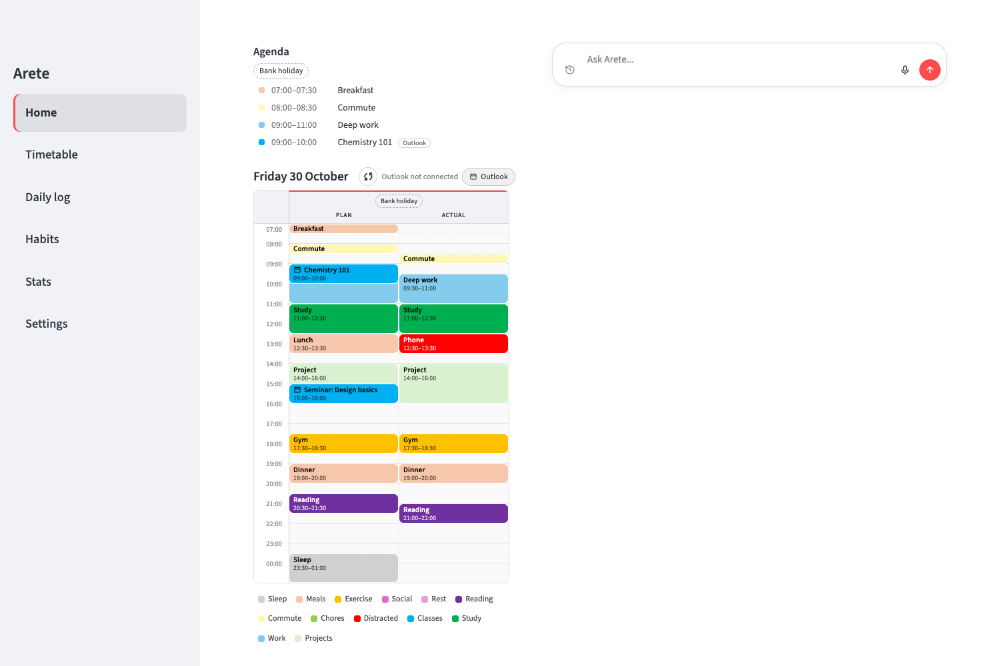

<p align="center">
  
</p>

<h1 align="center">Arete</h1>

<p align="center">
  Track everything, in one place, modifiable to your will.
</p>

<p align="center">
  A personal life tracker for your Mac or Windows PC: a weekly Plan-vs-Actual timetable, a daily log
  of mood, sleep, energy and water, a journal, habits with streaks, to-dos and goals, a map of the people you know, reminders before things start, and a Claude chat box that updates it all for you.
</p>

<p align="center"><em>No summit, just the climb.</em></p>

> **Version 1 (v1.0.0).** Home with to-dos, habits and goals; timetable; goals; daily log; stats;
> your network; and the Claude chat box. Keep backups (Settings → Data → Back up now). Bug reports
> and ideas are welcome in [Issues](https://github.com/spencertomj1-hue/arete-app/issues).

---

*Arete* (ἀρετή) is the Greek idea of excellence: living up to your potential. Arete helps by recording each day honestly: what you planned, what you actually did, how you felt and which habits you kept.

It runs entirely on your computer (Mac or Windows) as a normal app. It's built with [Streamlit](https://streamlit.io) and SQLite and shown in its own window. There are no accounts, no servers and no cloud sync.

## Contents

- [Features](#features)
- [Screenshots](#screenshots)
- [Requirements](#requirements)
- [Install](#install)
- [First run](#first-run)
- [Connecting Outlook](#connecting-outlook)
- [Setting up the Claude chat](#setting-up-the-claude-chat)
- [Privacy](#privacy)
- [Limitations](#limitations)
- [Troubleshooting](#troubleshooting)
- [For developers](#for-developers)
- [Licence](#licence)

## Features

**Home.** Today's agenda and timetable on the left. On the right: the box to ask Claude, your to-dos, today's habits to tick (with the last 7 days and your streak), and your goals' progress bars.

**To-dos (on Home).** Today's, this week's and this month's to-do lists, side by side, in the style of Apple Reminders.
- **Ticking off:** click the circle; the to-do moves into a folded "Completed" section. Click it again to untick.
- **Adding and editing:** click "New to-do", type, and press Enter (it stays open for the next one; Esc cancels). Click a title to edit it, drag to reorder, and right-click for notes, repeat, moving to another list, or delete. Repeating to-dos get a fresh copy every new day, week or month.

**Goals.** Measurable targets for the month or the year, like "Gym: 12 sessions" or "Read 20 books", each with a progress bar (on the Goals page and on Home).
- **Progress:** either update it yourself (− / + or type a number), or link the goal to a habit and every day you tick that habit counts.
- **Moving around:** ‹ › shows other months and years.

**Deadlines.** Things due on a date (an essay, an application), on the Goals page and on Home with a countdown ("in 3 days", red when overdue). They show on the timetable's day header and in Home's agenda, you get a reminder the day before and on the day, and **Make time** fits hours for one into your Plan before it's due.

**Weekly timetable.**
- **Layout:** a calendar-style week. Each day has a **Plan** column (what you intended) and an **Actual** column (what really happened), in 30-minute slots from 07:00 to 01:00. Anything after midnight counts as the previous day.
- **Editing:** drag down a column to add a block, or click a block to see its details, edit it or delete it. **Add block** does the same with a form (and the keyboard).
- **Categories:** colour-coded, with groups "Life" and "Work" to start with. Activities pick their category automatically (for example "Lunch" → Meals). **Categories** (above the grid) adds, renames and recolours them, sets those activity defaults, and picks Outlook events' colour.
- **Fit time:** say what (e.g. Revision), how many hours and which days; Arete finds free gaps around your blocks and Outlook events, spreads the sittings out and shows you the times before adding them.
- **Moving around:** use ‹ Today › or a date picker, or swipe sideways on the trackpad.

**Daily Log.** A month calendar showing each day's mood, sleep, energy and litres of water. Click a day to read its notes, tick that day's habits (with current and best streaks), and save its entry. Habits are added and removed here too, each either every day or with a weekly target (e.g. Gym 3 times a week: progress shows as "2/3 this week", and streaks count weeks that hit it).

**Network.** A map of the people you know, as a tree: you in the middle, a circle for each group branching off you, sub-groups branching off their group (e.g. Northfield → Physics Society, Robotics Lab), and people branching off the group they're in. Dashed lines join people who know each other.
- **Adding:** tell Arete ("add Physics Society inside Northfield", "Priya is in Physics Society and knows Sam from football"), or use "Add someone" / "Add group". A group's card also has "Add person here" and "Add sub-group".
- **Looking around:** click a person or group for its card (who they work for, a description, connections, members); click a name in a card to jump there. Drag to move things, scroll to zoom, search by name, and click a group in the legend to hide or show its whole branch.
- **Editing:** every card has an Edit button that opens a dialog to change details, add or remove connections, move groups, or remove things.
- **Times you've met:** log coffees, calls and catch-ups with someone (in their Edit dialog, or tell Arete "had coffee with Priya, talked about her thesis"). Their card shows when you last spoke and the latest few.

**Journal (in the Daily Log).** Each day's notes are its journal entry: a big writing box with a different prompt each day to get you started, and past entries listed below with a search box. Tell Arete "journal: ..." to add to today's entry, or ask "what did I write about Priya?".

**Reminders.** A desktop notification a few minutes before each block in your Plan (and each Outlook event) starts, while Arete is open. Turn it on or off and choose how early in Settings → Reminders.

**Stats.** Charts of mood, energy, sleep and water, plus habit completion rates.

**Claude assistant (optional).** Everything above works by hand. If you like, switch on the assistant (during setup, or in Settings → Assistant) for a chat box where you type or speak what you want changed, for example:
> "I went to the gym from 6 to 7 tonight"
> "Plan a lecture 9 till 11 tomorrow"
> "Fit 6 hours of revision into next week around my lectures"
> "Mood 4 today, slept 7 and a half hours, tick reading"
> "How much did I actually study this week?"
> "Add go gym to this week's to-dos"
> "Tick off finish problem sheet"
> "Set a goal of 12 gym sessions this month, counting my gym habit"
> "I read 2 more books"
> "Add Sam, a friend from uni who works at Northbank; she knows Alex from football"
> "Had coffee with Sam, talked about her thesis"
> "Drank 2 litres of water today"
> "Journal: long day in the lab, but the experiment finally worked"

Claude only changes Arete's data, through a fixed set of actions. **Anything that deletes or overwrites data shows a preview with Confirm / Cancel first.** Voice input is transcribed **on your computer**.

**Outlook calendar (optional).** Your published Outlook calendar appears in the timetable's Plan column, and you can remove or adjust any event. It's read only: nothing is ever written back to Outlook.

**Settings.**
- Appearance: light, dark, or follow your computer
- Calendar connection
- Claude sign-in status
- Microphone test
- Reminders: on/off, how many minutes before, and a test notification
- Automatic daily backups (keeps the last 30) to a folder you choose, e.g. iCloud Drive or OneDrive
- Backups, CSV export/import (with separate to-do and goal CSVs), journal download and the data folder

## Screenshots

*All screenshots use made-up demo data (see [For developers](#for-developers)).*

**Home**



**Weekly timetable**


**Asking Claude**


**Daily log**


**First-run setup**


**Settings**


<!-- Placeholders for future screenshots: assets/stats.png, assets/habits.png -->

## Requirements

- **A Mac** running macOS 11 or later (built and tested on macOS 26), **or a Windows 10/11 PC** (the tests run on Windows; the app window uses Microsoft Edge WebView2, which Windows 10/11 already has).
- **Python 3.13.** Install it from [python.org](https://www.python.org/downloads/) (on Windows, tick **Add python.exe to PATH**), or on a Mac with Homebrew: `brew install python@3.13`.
- **Git**, to download Arete: built into macOS; on Windows, install it from [git-scm.com](https://git-scm.com/download/win).
- **About 2 GB of free disk space:** roughly 1 GB for the packages, plus about 470 MB for the speech model the first time you use the microphone.
- **Optional, for the chat:** an [Anthropic API key](https://console.anthropic.com) (paste it in Settings → Claude), **or** [Claude Code](https://docs.claude.com/en/docs/claude-code) signed in with your own Claude account.

## Install

### The easy way: download it

Go to [Releases](https://github.com/spencertomj1-hue/arete-app/releases/latest) and download:
- **Windows:** `Arete-Setup.exe`. Run it. Windows may say "Windows protected your PC" because it isn't code-signed: click **More info → Run anyway**.
- **Mac (Apple silicon):** `Arete.dmg`. Open it and drag Arete into Applications. The first time, macOS says it can't check the app: open **System Settings → Privacy & Security** and click **Open Anyway**.

Nothing else to install. For the chat, paste an Anthropic API key in **Settings → Claude** (or sign in to Claude Code).

### From the source code (Mac)

Open the **Terminal** app and run:

```bash
git clone https://github.com/spencertomj1-hue/arete-app.git
cd arete-app
./setup.sh
```

`setup.sh`:
1. Checks for macOS and Python 3.13.
2. Installs the exact tested package versions into a private `.venv` folder.
3. Builds **Arete.app** in your Applications folder (or `~/Applications`), pointing at the folder you cloned.

It's safe to run again, for example after `git pull`.

Then open **Arete** from Applications, Launchpad or Spotlight. The first time, macOS may say it's from an unidentified developer: right-click Arete → **Open** → **Open**.

### From the source code (Windows)

Open **PowerShell** and run:

```powershell
git clone https://github.com/spencertomj1-hue/arete-app.git
cd arete-app
powershell -ExecutionPolicy Bypass -File .\setup.ps1
```

`setup.ps1` checks for Python 3.13, installs the tested packages into `.venv`, and adds an **Arete** shortcut to the Start menu and the desktop. It's safe to run again after `git pull`.

## First run

A short setup guide appears the first time. Every step can be skipped, and you can rerun it from **Settings → About**.

1. **Welcome:** what Arete does, and where your data lives.
2. **Claude:** the chat needs one of: an **Anthropic API key** (paste it in; easiest, nothing to install), or **Claude Code** signed in with your Claude subscription (it shows the commands, with copy buttons). Everything else works without it.
3. **Outlook calendar (optional):** see below.
4. **Microphone:** explains the microphone permission prompt and lets you test the mic.

## Connecting Outlook

In the setup guide or **Settings → Calendar**:

1. Open [outlook.office.com](https://outlook.office.com) and sign in.
2. Click the **Settings** cog → **Calendar** → **Shared calendars**.
3. Under **Publish a calendar**, pick your calendar and **Can view all details**, then click **Publish**.
4. Copy the **ICS** link (the one ending in `.ics`, not `.html`).
5. Paste it into Arete and press **Connect**.

Arete checks the link, shows how many events it found, and stores the link in your **macOS Keychain** (on Windows, the **Windows Credential Manager**). It syncs when the app opens, every 15 minutes, and when you press ↻.

**Anyone who has the link can see your calendar.** To revoke it, go back to Shared calendars and click **Unpublish** (or **Reset links** to get a new one).

## Setting up the Claude chat

The assistant is optional and off unless you switch it on (setup, or Settings → Assistant). It uses **your own** Claude access. Arete has no account or key of its own. Pick one:

- **Claude Code (recommended):**
  1. Install it: `curl -fsSL https://claude.ai/install.sh | bash`
  2. Sign in: `claude auth login`
  3. Arete finds it automatically. **Settings → Claude** shows the status.
- **An API key:** set `ANTHROPIC_API_KEY` in your environment before starting Arete.

Claude can only use Arete's own actions: logging days, ticking habits, editing the timetable, and reading your stats. It has no access to your files, terminal or the web, and doesn't load your other Claude settings or plugins.

## Privacy

**What stays on your computer:**
- **Your data:** the timetable, daily log, habits and settings, all in your data folder: `~/Library/Application Support/Arete/` on a Mac, `%APPDATA%\\Arete` on Windows. That folder is outside the app's folder, so it can never end up in git.
- **Voice:** recorded and transcribed locally with [faster-whisper](https://github.com/SYSTRAN/faster-whisper). Audio is never uploaded.
- **Your Outlook link:** stored only in the macOS Keychain / Windows Credential Manager.
- **Chat history:** kept in memory while the app is open, and **not saved to disk**. Claude Code runs with session saving turned off.
- **The app itself:** it only listens on `127.0.0.1` (this computer), with XSRF protection on and Streamlit's usage statistics off.

**What leaves your computer:**
- **Messages to Claude:** when you use the chat, your message, the recent conversation and whatever data Claude looks up to answer it (for example that week's timetable) go to Anthropic through your Claude Code login or API key, like any Claude conversation.
- **Calendar fetch:** if you connect Outlook, Arete downloads your published calendar from Microsoft.

Nothing else is sent anywhere.

## Limitations

- **Mac and Windows.** Windows support is new: the tests run on Windows, but report anything odd in Issues. Linux should work from a terminal (`.venv/bin/python desktop.py`) but has no installer yet.
- **The chat needs your own Claude access:** a Claude Code login or an Anthropic API key.
- **Outlook publishing may be blocked.** Some universities and workplaces turn off "Publish a calendar". If the option is missing, or Outlook refuses the link, ask your IT team.
- **Single user, single computer.** There's no sync between devices.
- **Timetable hours:** the grid covers 07:00–01:00. Events outside those hours are clipped.

## Troubleshooting

| Problem | What to try |
|---|---|
| **"Arete is from an unidentified developer"** | Right-click Arete → Open → Open (only needed once). |
| **setup.sh says Python 3.13 is missing** | Install it from python.org or with `brew install python@3.13`, then run `./setup.sh` again. |
| **The chat says Claude isn't logged in** | Run `claude auth login` in Terminal, then **Settings → Claude → Check again**. |
| **The chat can't find Claude Code** | Check `which claude` in Terminal (`where.exe claude` in PowerShell on Windows). If it's somewhere unusual, put `{"claude_path": "/path/to/claude"}` in `arete_config.json` in your data folder (see Privacy). |
| **"Outlook refused this link"** | Your organisation may block publishing (ask IT), or the link was reset; publish again and paste the new ICS link. |
| **The calendar header says "Offline"** | Arete keeps showing the last synced events; it syncs again when you're back online (or press ↻). |
| **The mic records silence** | Allow Arete in System Settings → Privacy & Security → Microphone. |
| **The app moved, or you moved the folder** | Run `./setup.sh` again to rebuild Arete.app. |
| **Starting over** | Quit Arete and move your data folder (`~/Library/Application Support/Arete`, or `%APPDATA%\Arete` on Windows) somewhere else, or delete it. |

## For developers

```bash
.venv/bin/python -m pytest -q -p no:logging tests      # the test suite
.venv/bin/python scripts/seed_demo.py                 # a demo data folder with fake data
ARETE_DATA_DIR=<folder> .venv/bin/streamlit run app.py  # run against any data folder
```

[`HANDOVER.md`](HANDOVER.md) is the developer guide: architecture, modules, tables and gotchas. Please read [`CONTRIBUTING.md`](CONTRIBUTING.md) before sending changes. **Never commit real data.**

## Licence

Arete is released under the [MIT licence](LICENSE).
